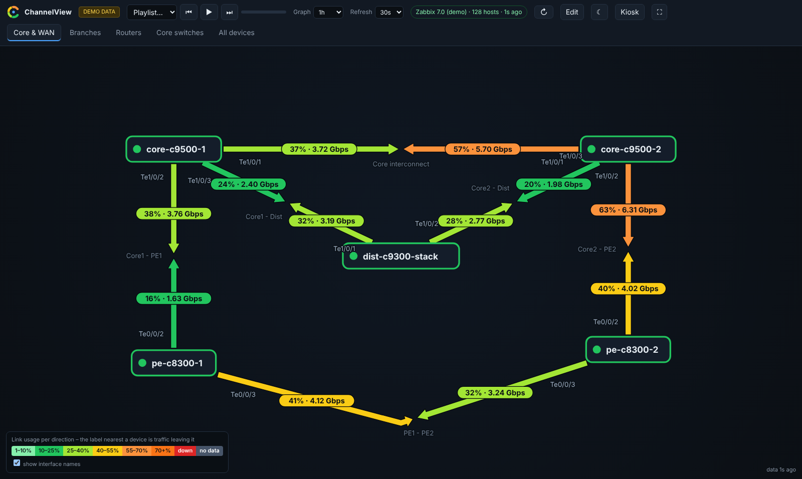
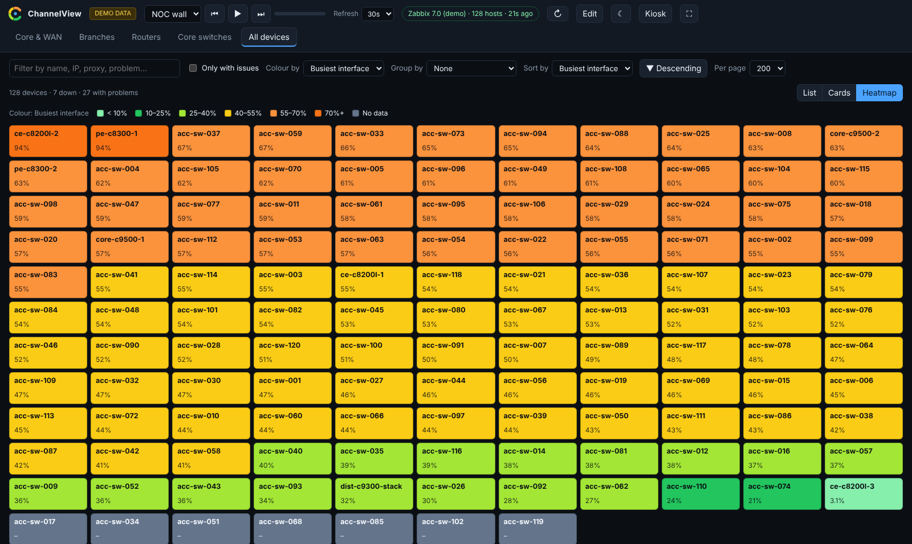

<h1 align="center">
  <picture>
    <source media="(prefers-color-scheme: dark)" srcset="docs/logo/trunkvista-logo-dark.svg">
    
  </picture>
</h1>

> **Download TrunkVista from the [latest release](https://github.com/Alastair33/TrunkVista/releases/latest)** - not with *Code → Download ZIP* and not by cloning: the branch can hold changes that are not released yet. [Details](#download)

A browser dashboard for **Zabbix 7.0**, built for Cisco gear behind Zabbix proxies and the servers next to it.

- **Weathermaps** - devices joined by interface links, coloured by status and utilisation, labelled with % and bit/s per direction. Hover a link for its traffic graph.
- **Device tabs** - cards, a sortable list or a heatmap, grouped by status, type, proxy, OS or model.
- **Servers** - CPU, memory, swap, load, disks and uptime of hosts monitored with the Zabbix agent. [More](docs/servers.md)
- **Playlists and kiosk mode** for wall displays, a built-in editor, dark and light themes.
- **Sign-in** with admin and viewer roles. The browser only talks to TrunkVista, never to Zabbix, and never sees the API token.
- One Python file, standard library only (Python 3.9+).





Try it without Zabbix: `python3 trunkvista.py --demo`, or open `trunkvista_demo.html` in a browser.

## Quick start (Debian / Ubuntu)

```
wget https://github.com/Alastair33/TrunkVista/releases/latest/download/trunkvista-latest.tar.gz
tar xzf trunkvista-latest.tar.gz
cd trunkvista
sudo ./install.sh
```

The only question is the **administrator's password** (Enter = a random one, kept for root in `/var/lib/trunkvista/initial-admin-password`). Then open **http://127.0.0.1:8088/**, sign in as `admin` and enter your **Zabbix** address and an API token (Zabbix: *Users → API tokens*; a read-only user is enough). The page tries them before it saves anything.

- No archive wanted: `curl -fsSL https://github.com/Alastair33/TrunkVista/releases/latest/download/install.sh | sudo sh`
- Other PCs or wall displays should open it: `sudo trunkvista-setup --network` (listens on the network and switches HTTPS on; `--local` goes back).
- Not Debian / Ubuntu: see [Without the package](#without-the-package).

## Download

Always take TrunkVista from the newest release, not from *Download ZIP* or a clone. The files keep the same names in every release:

| File | For |
|---|---|
| `trunkvista-latest.tar.gz` | Debian / Ubuntu: installer + package + checksum (works offline) |
| `install.sh` | Debian / Ubuntu: downloads, checks and installs the package |
| `trunkvista-latest.deb` | Debian / Ubuntu: the package alone |
| `trunkvista.py` | any system with Python 3.9+ |
| `trunkvista_demo.html` | a demo in the browser, no Zabbix needed |
| `SHA256SUMS` | checking the downloads: `sha256sum -c --ignore-missing SHA256SUMS` |

```
https://github.com/Alastair33/TrunkVista/releases/latest/download/trunkvista-latest.tar.gz
https://github.com/Alastair33/TrunkVista/releases/latest/download/install.sh
https://github.com/Alastair33/TrunkVista/releases/latest/download/trunkvista-latest.deb
https://github.com/Alastair33/TrunkVista/releases/latest/download/trunkvista.py
https://github.com/Alastair33/TrunkVista/releases/latest/download/trunkvista_demo.html
https://github.com/Alastair33/TrunkVista/releases/latest/download/SHA256SUMS
```

While the repository is private these only work in a browser signed in to GitHub; on a server use `gh release download --repo Alastair33/TrunkVista --pattern trunkvista-latest.deb --pattern SHA256SUMS`.

## Without the package

```
curl -fLO https://github.com/Alastair33/TrunkVista/releases/latest/download/trunkvista.py
python3 trunkvista.py user add NAME --role admin               # the first account
python3 trunkvista.py connection add https://zabbix.example.com   # asks for the API token, tries it, saves it
python3 trunkvista.py                                          # http://127.0.0.1:8088
```

Data lives in `~/.trunkvista` (`--data-dir` changes that). It does not restart after a reboot; use the Debian package for a service.

## Everyday use

```
sudo trunkvista-user add anna --role viewer                        # accounts: list, add, passwd, set, signout, delete
sudo trunkvista-user add wall1 --role viewer --idle never --password-stdin    # a wall display that stays signed in
sudo trunkvista-update                                             # install the newest release (--check only looks)
sudo systemctl enable --now trunkvista-update.timer                # or update every night
sudo trunkvista-cert                                               # self-signed HTTPS certificate (--network does this for you)
```

Admins edit and manage accounts and Zabbix connections; viewers only look. Locked out? `sudo trunkvista-user passwd NAME --must-change`.

## Troubleshooting

| Symptom | Look at |
|---|---|
| Page does not open | `systemctl status trunkvista`, `journalctl -u trunkvista -n 50`; port taken? set `TRUNKVISTA_PORT` |
| No data / "unconfigured" | click the status chip: URL, API token, **Test** |
| A server shows no CPU / memory / disks | **Test** says how many server items it found; items older than 5 minutes are left out, so check the agent is alive |
| Cannot sign in | the message is the same for a wrong name, a wrong password and a disabled account: `sudo trunkvista-user list` / `passwd NAME` |

More in the [administration guide](docs/administration.md#troubleshooting).

## More

- [Administration guide](docs/administration.md) - install details, `trunkvista-setup`, accounts, HTTPS and your own certificate, updates and signatures, where files live, backup and removal, upgrading from ChannelView
- [Servers](docs/servers.md) - which Zabbix items are read and how
- [Changing the design](docs/customizing.md) - `custom.css`, themes, the logo
- [Maintainer guide](docs/maintainer.md) - releases, signing, development
- [Release notes](CHANGELOG.md) and the [Releases page](https://github.com/Alastair33/TrunkVista/releases)

## Development

```
python3 trunkvista.py --demo                       # run from a checkout
python3 -m unittest discover -s tests -v           # unit tests (some need openssl, git or node)
python3 tools/build_demo.py trunkvista_demo.html   # rebuild the demo page after changing the dashboard page
```

## Licence

[MIT](LICENSE) - free to use, copy, modify and share, provided the copyright notice stays with it. No warranty.
