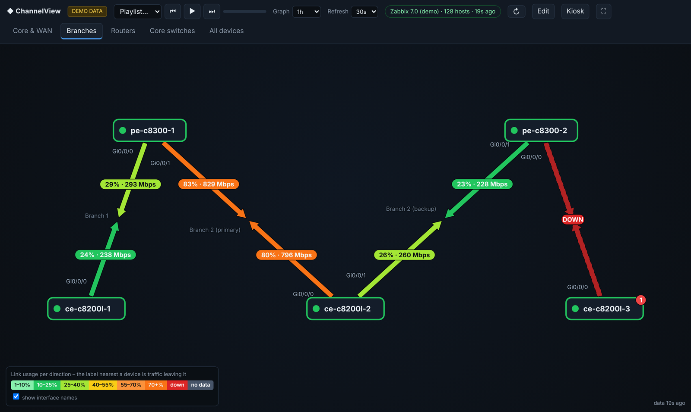
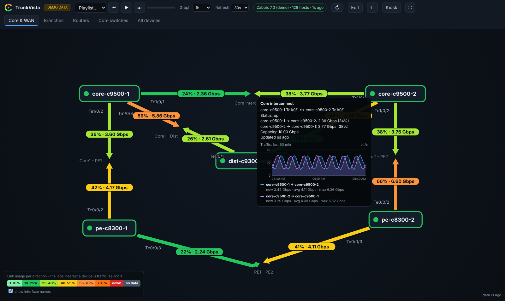
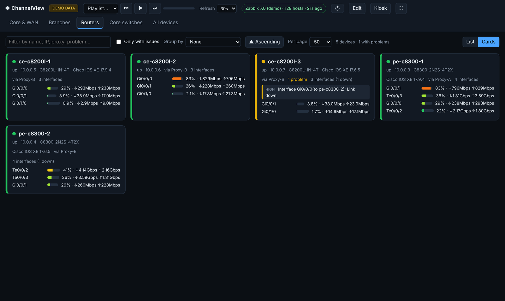
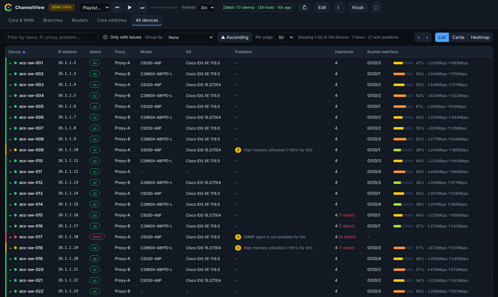
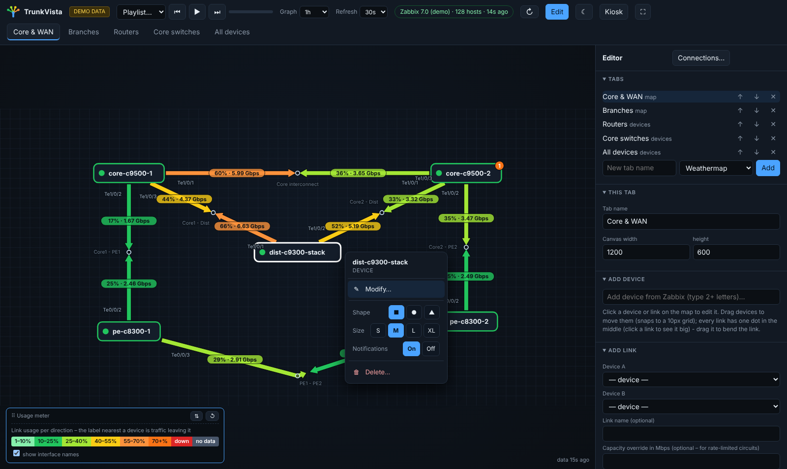
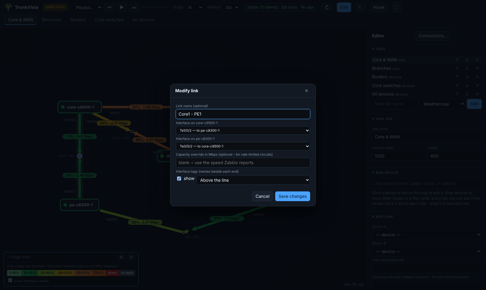
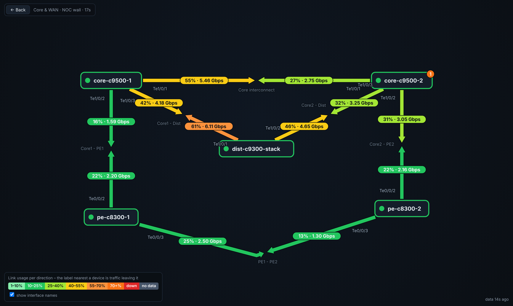

<h1 align="center">
  <picture>
    <source media="(prefers-color-scheme: dark)" srcset="docs/logo/channelview-logo-dark.svg">
    
  </picture>
</h1>

ChannelView is a browser dashboard for **Zabbix 7.0** (built for Cisco gear behind one or more Zabbix proxies):

- **Weathermap tabs** – devices joined by interface links; each link is coloured by status and utilisation and labelled with % and bit/s per direction. Hover a link for an in / out traffic graph.
- **Device tabs** – cards or a sortable list, grouped by status, proxy, OS, model, …
- **Playlists** and a kiosk mode for NOC wall displays, a built-in editor, a connection menu for your Zabbix API.
- One Python file, standard library only. Works in Chrome and Firefox. The browser only ever talks to this program, never to Zabbix, and never sees the API token.

```
python3 channelview.py --demo      # try it with simulated Cisco devices, no Zabbix needed -> http://127.0.0.1:8088
channelview_demo.html              # or just open this file in a browser: a standalone demo
```

## Screenshots

All of these show the built-in demo data (simulated Cisco devices), so no real network is on display.

**Weathermap.** Each link is coloured by its utilisation and labelled with % and bit/s for each direction; the legend shows the scale.


**Status at a glance.** A link whose interface is down turns red and says DOWN; a device with open problems gets a numbered badge.



**Link hover.** The card shows the status, both directions, the capacity and an in / out traffic graph (range selectable in the header).



**Device tabs.** Cards or a sortable list, with a filter, grouping, paging, and the busiest interfaces per device.




**Editor.** Edit mode: tabs, devices (added from Zabbix) and links; right-click a device or link for the shape, size, notifications, modify and delete.




**Playlists and kiosk mode.** A playlist rotates through tabs on a timer; kiosk mode hides the header and the controls (a Back button and the playlist progress remain), for a wall display.



## Install on Debian / Ubuntu

Supported: Debian 11+, Ubuntu 22.04+ (anything with Python 3.9+ and systemd).

1. Download `channelview_<version>_all.deb` from the repository's **Releases** page.
2. Install it:

   ```
   sudo apt install ./channelview_1.1.0_all.deb
   ```

   This creates the `channelview` system user, installs the systemd service `channelview`, enables it and starts it.
3. Open `http://127.0.0.1:8088` on that machine, click the status chip at the top (or press **C**) and add your Zabbix: URL (`https://zabbix.example.com`) and an **API token** (Zabbix: *Users → API tokens → Create API token*; a read-only user that can see your hosts is enough) → **Test** → **Save & use**.

Check on it:

```
systemctl status channelview
journalctl -u channelview -f
```

### Making it reachable from other PCs / wall displays

By default it listens on `127.0.0.1` only. Edit `/etc/default/channelview`:

```
CHANNELVIEW_HOST=0.0.0.0
```

then `sudo systemctl restart channelview` (open the port in your firewall if you run one).

- **Viewing needs no login** – anyone who can reach the port sees the dashboard. Put it on a trusted network.
- **Editing needs the edit token**: `sudo cat /var/lib/channelview/edit_token`, then open `https://<server>:8088/?token=<token>` once in the browser you edit from. Browsers on the server itself (127.0.0.1) are trusted automatically.
- A port below 1024 needs `sudo systemctl edit channelview` → `[Service]` / `AmbientCapabilities=CAP_NET_BIND_SERVICE`.

### HTTPS (do this as soon as other PCs open it)

Without HTTPS the edit token and everything else cross the network readable. The dashboard serves HTTPS **itself** – no Apache or Nginx needed.

```
sudo channelview-cert          # self-signed certificate for this machine -> /etc/channelview/tls/
```

Add the two lines it prints to `/etc/default/channelview` (a fresh install has them there, commented out; after an upgrade from 1.0.0 you add them), then restart:

```
CHANNELVIEW_TLS_CERT=/etc/channelview/tls/server.crt
CHANNELVIEW_TLS_KEY=/etc/channelview/tls/server.key
```
```
sudo systemctl restart channelview      # now:  https://<server>:8088/
```

- Typing `http://` on that port redirects to `https://`. TLS 1.2 or newer only.
- **Browser warning:** a self-signed certificate is not trusted until you import `server.crt` as a trusted certificate on each PC / kiosk that opens the page. With a certificate from your own CA or Let's Encrypt there is no warning.
- **Your own certificate:** point the two settings at your files. The certificate file holds the full chain (certificate first); the key must be readable by the group `channelview` (`chgrp channelview key.pem && chmod 640 key.pem`). The key may also sit in the certificate file – then leave `CHANNELVIEW_TLS_KEY` out.
- **Renewal needs no restart.** The files are looked at again when they change (checked on new connections, about every 10 s). `sudo channelview-cert --force` or certbot is enough. If the new files do not load (the key does not match, a file is half written) the old certificate stays in use and the log says so.
- A wrong certificate path or a key that does not fit stops the service at start with the reason in `journalctl -u channelview`.
- Let's Encrypt, as an example of a deploy hook (`/etc/letsencrypt/renewal-hooks/deploy/channelview`, adjust the paths):

  ```
  #!/bin/sh
  install -D -m 0644 "$RENEWED_LINEAGE/fullchain.pem" /etc/channelview/tls/server.crt
  install -D -m 0640 -g channelview "$RENEWED_LINEAGE/privkey.pem" /etc/channelview/tls/server.key
  ```
- **Reverse proxy instead?** Not needed. If you want one anyway (one address for several tools), run it on **another machine**, require authentication there, and let only that machine reach the port. A proxy on the *same* machine connects from 127.0.0.1, which the dashboard treats as the local administrator – every viewer behind it would get the edit token.

## Updating from GitHub

```
sudo channelview-update              # shows what is new, asks, installs, restarts the service
sudo channelview-update --check      # only look; exit status 10 = an update is available (handy for monitoring)
sudo channelview-update --yes        # no question
sudo channelview-update --version 1.0.0 --force     # go back to a given release
sudo channelview-update --channel prerelease        # release candidates too (or CHANNELVIEW_UPDATE_CHANNEL=prerelease in /etc/default/channelview)
```

It reads `CHANNELVIEW_UPDATE_REPO` from `/etc/default/channelview` (the release workflow fills in your repository), downloads the `.deb` and `SHA256SUMS` of the newest release, checks them, and installs with `apt`. Your settings in `/etc/default/channelview`, your connections, layouts and the edit token are kept.

**Automatic updates** are off. To check every night (about 03:30, random delay up to an hour) and install:

```
sudo systemctl enable --now channelview-update.timer
```

Look at it with `systemctl list-timers channelview-update.timer` and `journalctl -u channelview-update`.

**Private repository:** put a GitHub token (fine-grained, read-only access to *Contents* of this repository) in a file, `chmod 600` it, and set `CHANNELVIEW_UPDATE_TOKEN_FILE=/path/to/file` in `/etc/default/channelview`. The token is only ever sent to the GitHub API.

### What protects an update

- Every release carries `SHA256SUMS`; the update refuses a `.deb` that does not match it, and a release without `SHA256SUMS`.
- It checks that the file really is `channelview` for `all` architectures with the announced version before installing.
- **Optional signature.** If `/etc/channelview/release-key.gpg` exists, `SHA256SUMS` must carry a valid GPG signature (`SHA256SUMS.sig`) from that key, otherwise nothing is installed. Set it up once, see *Signing releases* below.
- Without a signature the trust is "whoever can publish a release in the repository". With one it is "whoever holds the signing key". Either way you are installing code that runs as a service on your server: keep the GitHub account protected (2FA) and the repository private if the dashboard shows anything you would rather not publish.

## Changing the design

**Quick, on the server – `custom.css`.** Your own style rules, added after the built-in ones. The file lives in the data folder, so updates never touch it, and it is read at every page load (edit, press F5 – no restart).

```
sudo nano /var/lib/channelview/custom.css
```
```css
:root { --accent: #ff9f1a; --bg: #05080c; }     /* colours of the interface */
body  { font-size: 15px; }
```

| Variable | Used for |
|---|---|
| `--bg` | page background, input fields |
| `--panel`, `--panel2` | header, side panels, dialogs, cards |
| `--line` | borders and separators |
| `--text`, `--muted` | normal and secondary text |
| `--accent` | selected items, links, highlights |
| `--ok`, `--bad`, `--warn` | green / red / amber in the interface (badges, buttons) |

This restyles the **interface** (header, panels, buttons, text, fonts, sizes). The colours of the map itself – link colours, the usage scale, device status dots – are drawn by the program and are changed in a release, see below. Press F12 in the browser to find the element and class names for finer rules. Delete the file to go back to the built-in look. Size limit 256 KB.

**The logo.** The header shows the mark (a C of link segments in the usage colours around a blue node) and the browser tab uses the same drawing as its icon. The centre node follows `--accent`, so a changed accent colour changes it too; to remove the mark from the header, add `.logo svg { display: none; }` to `custom.css`. All logo files (SVG, PNG, favicon, social preview) and the rules for using them are in [`docs/logo`](docs/logo/README.md).

**Bigger changes, for everybody – a release.** The whole page (HTML, CSS, JavaScript) is the `PAGE` text in `channelview.py`.

1. Change it and look: `python3 channelview.py --demo` (reload the browser after each change).
2. Write what changed under `## [Unreleased]` in `CHANGELOG.md`.
3. Release it (*Patching and releasing* below). Every server then offers it with `sudo channelview-update`.

## Setting up GitHub and the first release (maintainer)

One-time setup:

```
cd ChannelView
git init -b main
git add -A && git commit -m "Initial import"
git remote add origin git@github.com:<you>/<repository>.git
git push -u origin main
```

The first release (the notes are already written under `## [1.1.0]`; later ones: *Patching and releasing* below):

```
packaging/release.sh --push 1.1.0
```

What happens after the push: GitHub Actions (`.github/workflows/release.yml`) runs the tests, builds the `.deb`, **installs / upgrades / updates / removes / purges it on a clean runner**, and publishes the release with `channelview_1.1.0_all.deb`, `channelview_demo.html`, `SHA256SUMS` (and `SHA256SUMS.sig`). If anything fails nothing is published – fix it, delete the tag (`git push --delete origin v1.1.0; git tag -d v1.1.0`) and release again. Servers get it with `sudo channelview-update`.

A tag with a dash (`v1.2.0-rc.1`) is a **pre-release**: only servers on the `prerelease` channel see it. Inside the package its version is `1.2.0~rc.1`, which sorts before `1.2.0`. The file is called `channelview_1.2.0-rc.1_all.deb` because GitHub renames a `~` in file names.

The workflow refuses a tag that does not match `VERSION`.

`.github/workflows/ci.yml` runs the tests, shellcheck, a demo-page check and the install test on every push and pull request.

### Signing releases (optional, recommended)

```
gpg --quick-generate-key "ChannelView releases" ed25519 sign never      # choose a passphrase
gpg --armor --export-secret-keys "ChannelView releases"                 # -> GitHub: Settings > Secrets and variables > Actions > RELEASE_GPG_PRIVATE_KEY
                                                                             #    (the passphrase goes into the secret RELEASE_GPG_PASSPHRASE)
gpg --export "ChannelView releases" > release-key.gpg                   # the public key, for the servers:
sudo apt install gpgv
sudo install -D -m 0644 release-key.gpg /etc/channelview/release-key.gpg
```

From the next release on the workflow signs `SHA256SUMS`. From the moment the key file exists on a server, that server installs **only** signed releases – do the first signed release before you copy the key to the servers.

## Patching and releasing (maintainer)

`VERSION` in `channelview.py` is the only place a version lives; `packaging/release.sh` sets it.

| Command | Use it for | Example |
|---|---|---|
| `packaging/release.sh patch --push` | a fix or a small design change | 1.1.0 → 1.1.1 |
| `packaging/release.sh minor --push` | a new feature | 1.1.0 → 1.2.0 |
| `packaging/release.sh major --push` | something that changes how it is used | 1.1.0 → 2.0.0 |
| `packaging/release.sh 1.1.1-rc.1 --push` | a pre-release for trying it first | – |

It needs notes under `## [Unreleased]` in `CHANGELOG.md` (they become the release notes), runs the unit tests (a failure puts everything back), commits, tags, and with `--push` pushes – GitHub Actions does the rest. Without `--push` it stops before publishing and tells you how to undo.

**Try a patch on one server first:** release `1.1.1-rc.1`, then on a test server `sudo channelview-update --channel prerelease`. If it is good, release the final version with `packaging/release.sh 1.1.1 --push` (the notes are still under `[Unreleased]`); servers on the normal channel only ever see that one.

**Back out a bad release:** on each server `sudo channelview-update --version 1.1.0 --force`, then fix and release again. Do not delete a release servers have installed.

## Where things are

| What | Where |
|---|---|
| Program | `/usr/lib/channelview/channelview.py` (command `channelview`) |
| Updater, certificate helper | `/usr/bin/channelview-update`, `/usr/bin/channelview-cert` |
| Service, update service and timer | `/lib/systemd/system/channelview*.service`, `channelview-update.timer` |
| Settings (listen address, port, update repository / channel) | `/etc/default/channelview` – kept on upgrades |
| Data: connections (Zabbix API token, owner-only), layouts, edit token | `/var/lib/channelview/` (`connections.json`, `dashboard*.json`, `edit_token`) |
| Your style rules (optional) | `/var/lib/channelview/custom.css` |
| HTTPS certificate and key (optional) | `/etc/channelview/tls/` (`server.crt`, `server.key`) |
| Signing key for updates (optional) | `/etc/channelview/release-key.gpg` |

The service runs as its own user `channelview`, sandboxed by systemd (no access to home directories, read-only system, only its data folder is writable).

**Backup:** copy `/var/lib/channelview` (it holds the API token – treat the copy as a secret).

**Remove:** `sudo apt remove channelview` removes the program, keeps settings and data. `sudo apt purge channelview` also removes `/etc/default/channelview`. Data, the user and `/etc/channelview` (certificate, keys) are **kept** even on purge, so a reinstall picks up where you left off; to delete them for good: `sudo rm -rf /var/lib/channelview /etc/channelview && sudo deluser --system channelview`.

## Troubleshooting

| Symptom | Look at |
|---|---|
| Page does not open | `systemctl status channelview`, `journalctl -u channelview -n 50`; port taken? change `CHANNELVIEW_PORT` |
| Service stops right after enabling HTTPS | `journalctl -u channelview -n 20` – "Cannot use the TLS certificate": wrong path, key does not fit, or the key is not readable by the group `channelview` |
| Browser: "not secure" / certificate warning | the certificate is self-signed: import `server.crt` on that PC, or use a certificate from your CA / Let's Encrypt; the name in the address must be one of the names `channelview-cert` printed |
| "editing is locked" | open the page with `?token=…` (see above) |
| Page shows no data / "unconfigured" | Connections menu (click the status chip): URL, API token, **Test** |
| Updater: "no stable release" | the repository has no non-pre-release release yet, or `CHANNELVIEW_UPDATE_REPO` is wrong; private repository → token file |
| Updater: "releases must be signed" | `/etc/channelview/release-key.gpg` exists but the release is not signed – sign it, or remove the key file |
| Updater: "API rate limit is used up" | GitHub allows 60 unauthenticated API calls per hour per address; use a token file |

## Development

```
python3 channelview.py --demo                       # run from a checkout
python3 -m unittest discover -s tests -v              # unit tests: app, HTTPS (needs openssl), updater against a fake GitHub, release script (needs git)
python3 tools/build_demo.py channelview_demo.html   # rebuild the standalone demo page after changing the dashboard page
packaging/build_deb.sh                                # -> dist/channelview_<version>_all.deb + SHA256SUMS (needs dpkg-deb)
sudo tests/e2e_debian.sh                              # really installs / upgrades / purges the package - only on a throw-away machine
```

## Licence

Not chosen yet. Until you add a `LICENSE` file, nobody else may use or copy the code. Update `packaging/deb/copyright` when you do.
